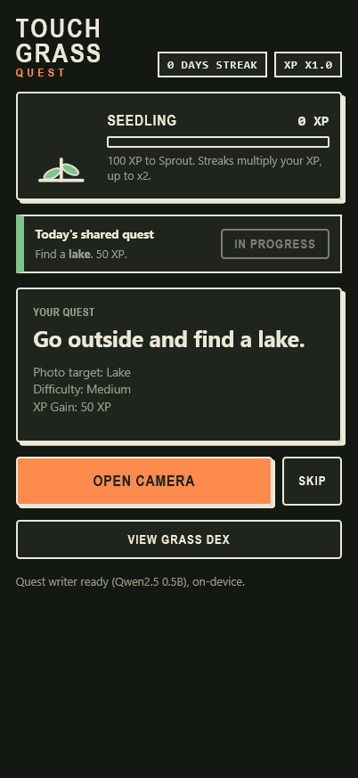
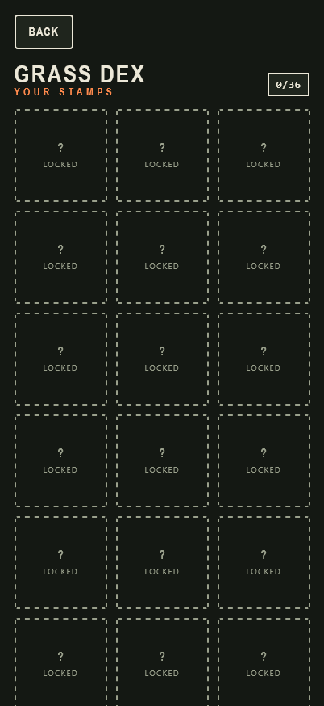

# Touch Grass Quest

A mobile-first web game that gets you off the screen: it hands you small
outdoor quests (find moss, a feather, the moon...), you photograph them with
the in-app live camera, and an on-device AI verifies the photo. Correct photos
earn XP, streaks multiply it, and your plant grows from seedling to blossoming
tree.

## Why open models

Everything runs on-device in the browser: no server, no account, and your
photos never leave your phone. After the first load the app works offline. The
models are swappable constants at the top of the script in `index.html` — a
pinned transformers.js build loads an open-weight CLIP model for photo checks
and a small open LLM (Gemma, with a Qwen fallback) for quest text.

## How it works

- **Quest** — each day brings a small pool of quests (2 easy, 2 medium,
  1 hard) plus one shared daily quest for the community. Skip rotates within
  the pool; finishing all five ends the day's set.
- **Live camera** — check-ins use the live camera only, so stock photos and
  screenshots don't count (file upload exists only in `?dev` mode for testing).
- **CLIP check** — zero-shot classification must rank your quest target top
  with enough confidence, or the photo is rejected with the model's best guess.
- **XP** — easy quests earn 10 XP, medium 20, hard 40, the shared quest a flat
  50. Time spent away from the screen adds a small bonus.
- **Streak multiplier** — completing quests on consecutive days multiplies XP,
  from x1.0 up to x2.0.
- **Plant** — XP grows a drawn plant through Seedling, Sprout, Young plant,
  Tree, and Blossoming tree. Neglect droops it until your next quest.
- **Grass Dex** — every verified target becomes a stamp; unseen ones stay
  hidden, and shared-quest finds earn bonus stamps.
- **Shared daily quest** — one curated target per day, same for everyone, worth
  a flat 50 XP base.
- **Away bonus** — time with the tab hidden earns up to +20 XP per quest,
  rewarding time spent outside the app.

## Run it locally

```sh
python -m http.server 8000
```

Then open `http://localhost:8000/?dev` (`?dev` enables file upload for testing
and skips waiting times). No build step. Deploy by serving the folder as-is
(e.g. GitHub Pages).

## Limitations

- Honor system: a screen showing a photo can still be photographed; the live
  camera only raises the bar.
- The small on-device models write imperfect quest text, so every line is
  filtered and templates are used as a fallback.
- The first load downloads large model files (cached afterwards); later loads work
  offline.

## Screenshots




