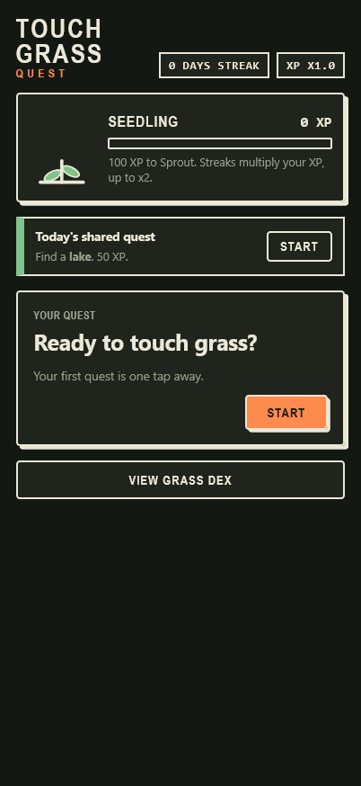

# Touch Grass Quest

A scavenger-hunt game that sends you outside. Every day you get outdoor quests ("find a pinecone", "spot a puddle"), take a photo with the in-app camera, and an AI running **on your phone** checks whether you found it. Finds earn XP that grows a plant, and every find becomes a stamp in your Grass Dex.

Built for the [Hacktoberfest Open-Source AI Challenge, Week 1: Touch Grass](https://dev.to/challenges/hacktoberfest-week1-2026-10-05).

**Live app:** https://albertbenedict.github.io/touch-grass/

## How it works

- **Daily quests:** five a day (2 easy, 2 medium, 1 hard) plus one shared quest that everyone gets on the same day.
- **Live camera only:** there's no gallery upload, so you have to go somewhere. (Append `?dev` to the URL to enable file upload for desktop testing.)
- **Photo check:** CLIP compares your photo against the quest target and a set of "none of the above" labels. The target must be the top guess with enough confidence.
- **Cooldown:** a 3-minute pause after each check, so you can't farm quests from the couch.
- **XP:** 10 / 20 / 40 for easy / medium / hard, and 50 for the shared quest.
- **Streak multiplier:** x1.0 up to x2.0 for consecutive days.
- **Away bonus:** +1 XP for every 2 minutes the app was in the background during a quest, up to +20.
- **Plant:** grows at 0 / 100 / 400 / 1000 / 2500 XP (Seedling, Sprout, Young plant, Tree, Blossoming tree). It droops after 3 days away and recovers with one quest.
- **Grass Dex:** 36 stamps to collect, with locked "?" stamps until you find them.

## Why open models

- **Photos never leave your phone.** Everything runs in the browser, with no backend, no account, and no API key.
- **Works offline after the first load.** A service worker caches the app, and the model files are cached by the browser.
- **Free to run.** It's a static site.
- **Swappable models.** The model IDs are constants at the top of the script.

| Job | Model | Notes |
| --- | --- | --- |
| Photo check | `Xenova/clip-vit-base-patch32` | zero-shot image classification |
| Quest text | Gemma 3 270M, falling back to Qwen2.5 0.5B | the first one that loads is used; templates are the last fallback |

Models are loaded from Hugging Face with [transformers.js](https://github.com/huggingface/transformers.js) (pinned version, loaded from jsDelivr) and have their own licenses.

## Run it locally

```
python -m http.server 8000
```

Then open `http://localhost:8000/`. The camera needs HTTPS or localhost, so don't open the file directly. The first load downloads the model files.

Progress is stored in your browser's `localStorage` under the key `tgq`.

## Limitations

- **Honor system:** you can still photograph a screen, and real anti-cheat would need a server.
- **Framing matters:** in my testing, a tree photographed from too far away or too close up failed the check.
- **Small models:** the quest writer is tiny and sometimes drifts off-topic, so its output is validated and falls back to templates.
- **The shared quest is the same for everyone,** so it can be impossible in some places (not everyone lives near a lake).
- **The first load downloads large model files.**

## Screenshots




## License

MIT, see [LICENSE](LICENSE).
